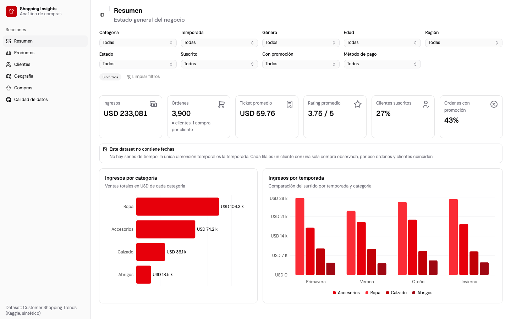
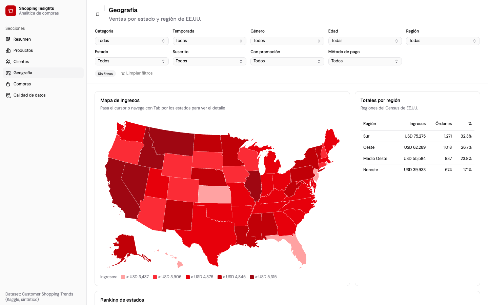
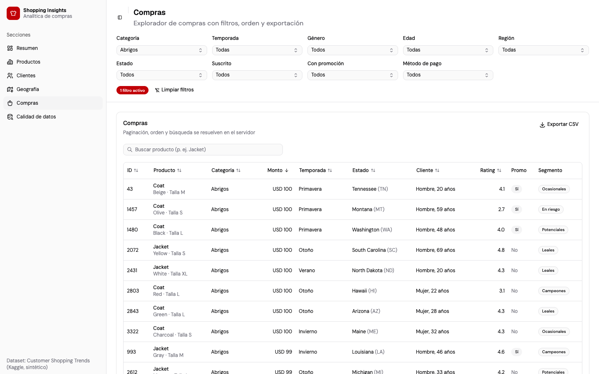
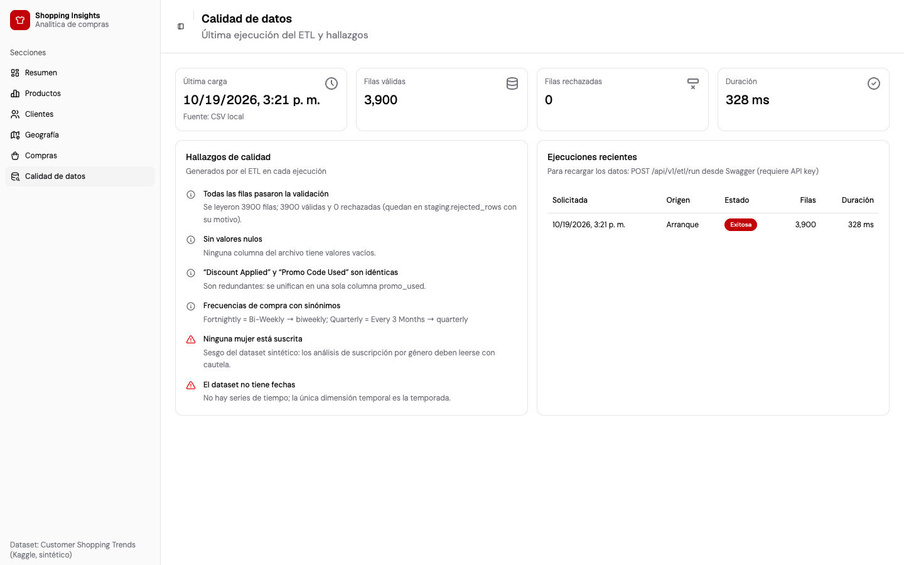

# Shopping Insights · Web

Dashboard del proyecto **Shopping Insights** sobre el dataset
[Customer Shopping Trends](https://www.kaggle.com/datasets/iamsouravbanerjee/customer-shopping-trends-dataset).
Hecho con **TanStack Start** (SSR), Router, Query y Table, **shadcn/ui**, Recharts y d3-geo.

El proyecto ocupa tres repositorios:

| Repo | Contenido |
|---|---|
| [`shopping-insights-etl`](https://github.com/D4v13B/shopping-insights-etl) | ETL: extracción, validación, transformación y carga |
| [`shopping-insights-api`](https://github.com/D4v13B/shopping-insights-api) | API, esquema y migraciones, roles de la base y Docker Compose del stack completo |
| **`shopping-insights-web`** (este) | Dashboard |



| Geografía | Explorador de compras | Calidad de datos |
|---|---|---|
|  |  |  |

## Funcionalidad

| Vista | Qué responde |
|---|---|
| **Resumen** | KPIs (ingresos, órdenes, ticket, rating, % suscritos, % con promo), ingresos por categoría y por temporada |
| **Productos** | Top 10 por ingresos, órdenes o rating; matriz categoría × temporada |
| **Clientes** | Segmentos (Campeones, Leales, En riesgo, Potenciales, Ocasionales), edad × género, suscritos vs. no suscritos |
| **Geografía** | Mapa coroplético accesible por teclado, totales por región y ranking de los 50 estados |
| **Compras** | Tabla con paginación, orden y búsqueda en el servidor; exportación a CSV con los mismos filtros |
| **Calidad de datos** | Última ejecución del ETL, hallazgos del reporte de calidad y ejecuciones recientes |

Los 9 filtros globales (categoría, temporada, género, edad, región, estado, suscripción,
promoción y método de pago) se guardan en la URL: un enlace copiado reproduce exactamente la vista y
el estado sobrevive a una recarga.

## Ejecutar con Docker (stack completo)

La web necesita la API en marcha. Todo se levanta desde el repo de la API, con los tres repos
clonados como carpetas hermanas:

```bash
git clone https://github.com/D4v13B/shopping-insights-etl.git
git clone https://github.com/D4v13B/shopping-insights-api.git
git clone https://github.com/D4v13B/shopping-insights-web.git

cd shopping-insights-api
cp .env.example .env
docker compose up --build
```

Dashboard en <http://localhost:3000>.

La imagen también se puede construir sola:

```bash
docker build --build-arg VITE_API_URL=http://localhost:8080 -t shopping-insights-web .
docker run -p 3000:3000 -e API_INTERNAL_URL=http://host.docker.internal:8080 shopping-insights-web
```

## Instalación y ejecución local

Requisitos: **Bun 1.3** (instala y ejecuta los scripts; el servidor de producción corre en
**Node 24**) y una API en marcha (por defecto en `http://localhost:8080`).

```bash
bun install
cp .env.example .env
bun run dev               # http://localhost:3000
```

Para producción:

```bash
bun run build
node server.mjs           # o: bun run start
```

## Variables de entorno

Ver [`.env.example`](.env.example).

| Variable | Cuándo | Descripción |
|---|---|---|
| `VITE_API_URL` | Build | URL de la API desde el navegador; se incrusta en el bundle |
| `API_INTERNAL_URL` | Runtime (SSR) | URL de la API desde el servidor (en Docker: `http://api:8080`) |
| `INTERNAL_API_TOKEN` | Runtime (SSR) | Mismo valor que en la API: exime al SSR del rate limit |
| `PORT` | Runtime | Puerto del servidor (3000) |

## Contrato con la API

La web no escribe tipos a mano: `openapi.json` es una copia versionada del contrato de la API y
`src/contract/api.d.ts` se genera desde él con `openapi-typescript`. `src/lib/api.ts` usa
`openapi-fetch` con esos tipos.

```bash
bun run sync:api                                        # desde ../shopping-insights-api/openapi.json
bun run sync:api http://localhost:8080/openapi.json     # o desde una API en marcha
```

Si la API cambia su contrato, `sync:api` actualiza ambos archivos y `bun run typecheck` señala lo que
hay que ajustar. El CI falla si `src/contract/api.d.ts` no coincide con `openapi.json`.

## Scripts

| Comando | Qué hace |
|---|---|
| `bun run dev` | Servidor de desarrollo con SSR en el puerto 3000 |
| `bun run build` / `start` | Build de producción / servidor Node (srvx) |
| `bun run lint` | Biome (lint y formato) |
| `bun run typecheck` | `tsc --noEmit` |
| `bun run test` | Vitest + Testing Library + MSW (no necesita la API) |
| `bun run sync:api [origen]` | Copia el contrato y regenera los tipos |
| `bun run gen:types` | Solo regenera los tipos desde `openapi.json` |

## Calidad y pruebas

- **Vitest** (26 tests): formato `es-PA`, filtros en la URL, tabla en modo servidor, cliente API con
  MSW, mapa y hallazgos de calidad.
- **Accesibilidad**: mapa navegable por teclado con tabla alternativa, etiquetas asociadas a cada
  filtro y estados de carga, vacío y error por ruta.
- **CI** (GitHub Actions): Biome, `tsc`, tipos al día con el contrato, Vitest, build y build de la
  imagen.

## Estructura

```
shopping-insights-web/
├── src/
│   ├── routes/         # Vistas (resumen, productos, clientes, geografía, compras, calidad)
│   ├── components/     # charts, filters, layout, purchases, common y ui (shadcn)
│   ├── lib/            # Cliente API, queries, filtros, formato
│   ├── hooks/
│   └── contract/       # Tipos generados del contrato OpenAPI
├── openapi.json        # Copia versionada del contrato de la API
├── scripts/            # sync-contract
├── server.mjs          # Servidor de producción (Node + srvx)
├── test/
├── docs/               # Capturas y ADRs
└── Dockerfile
```

## Limitaciones y mejoras futuras

- Tests E2E con Playwright en CI contra el stack completo.
- Autenticación OIDC con roles por usuario.
